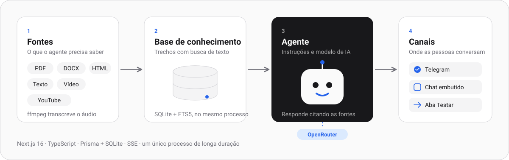

<h1 align="center">
  
</h1>

<p align="center">
  
</p>

Plataforma de agentes de IA com base de conhecimento própria. Você cria agentes, escolhe o modelo de linguagem (via OpenRouter), alimenta a base com arquivos, textos e vídeos e publica o agente no Telegram e num chat embutido em qualquer site com um script.

O projeto é construído por features, na ordem de `docs/projeto/MAPA.md`. Hoje existem a fundação (login, papéis, painel, cadastro de usuários, perfil e troca de senha, num layout de SaaS com tema claro e escuro) e os agentes com a chave do OpenRouter. Conversa de teste, base de conhecimento e canais chegam nas próximas features. O nome "Converse" é provisório e se troca por `APP_NAME`.

## Acesso de demonstração

Depois de `npm run setup` (veja [Como rodar](#como-rodar)), entre em `http://localhost:3000` com:

| Papel | E-mail | Senha |
|---|---|---|
| Administrador | `admin@exemplo.local` | `demo1234` |
| Usuário | `usuario@exemplo.local` | `demo1234` |

São contas fictícias da seed de desenvolvimento, que se recusa a rodar em produção. Em produção o primeiro administrador nasce por `npm run admin:criar` (veja [Operação e backup](#operação-e-backup)).

## Stack

| Camada | Tecnologia | Para que serve no projeto |
|---|---|---|
| Linguagem | TypeScript 5.9 (modo estrito) em Node.js 22, ESM | Todo o código, do servidor aos testes |
| Framework | Next.js 16 (App Router) e React 19 | Páginas, Server Actions e rotas de API no mesmo processo |
| Banco | SQLite em arquivo, com busca de texto FTS5 | Usuários, agentes, conversas, fontes e trechos da base de conhecimento |
| ORM | Prisma 7 com o adaptador `better-sqlite3` | Esquema, migrations e acesso ao banco |
| Validação | Zod 4 | Entrada das rotas e das ações |
| Autenticação | `jose` (JWT em cookie, renovado por atividade) e `bcryptjs` (hash de senha) | Sessão com revogação no logout e papéis administrador e usuário |
| Criptografia | AES-256-GCM (módulo `crypto` do Node) | Guarda a chave do OpenRouter e o token do Telegram criptografados |
| IA | OpenRouter (API compatível com OpenAI) | Respostas dos agentes e transcrição de áudio, com o modelo escolhido por agente |
| Base de conhecimento | `unpdf` (PDF), `mammoth` (DOCX), `parse5` (HTML), texto, vídeo e legendas do YouTube | Extração do texto das fontes, divisão em trechos e busca para fundamentar a resposta |
| Vídeo e áudio | `ffmpeg` e `ffprobe` | Extração do áudio, divisão em partes de 10 minutos e transcrição |
| Canais | Telegram (webhook) e chat embutido (`widget.js` e página `/embed`) | Publicação do agente em um bot e em qualquer site |
| Tempo real | Server-Sent Events | Resposta do agente trecho a trecho e andamento do processamento das fontes |
| Backup | `tar` e a API de backup online do SQLite | `npm run backup` e `npm run restore`, com manifesto e SHA-256 |
| Interface | CSS próprio com tokens (`src/estilos/tokens.css`), fontes Geist, Inter e Instrument Serif servidas localmente | Escala zinc, tema claro e escuro, sem serviço externo de fontes |
| Testes | Vitest 4 e `happy-dom` | Testes de unidade, de rotas e de arquitetura (`npm test`) |
| Qualidade | ESLint 9 e `tsc --noEmit` | Portões de lint e de tipos no CI |
| Entrega | Docker (`node:22-bookworm-slim` com `ffmpeg`, usuário não-root), Docker Compose e GitHub Actions | Imagem de produção com healthcheck em `/api/saude` e pipeline de lint, tipos, build, testes e auditoria |

Observações de arquitetura:

- **Um processo de longa duração.** SQLite em arquivo, disco local e a fila de processamento em segundo plano não rodam em função serverless. O HTTPS fica a cargo de um proxy reverso (exemplo com Caddy em [Operação e backup](#operação-e-backup)).
- **Camadas.** `src/app` (telas e rotas), `src/servicos` (regras de negócio), `src/lib` (infraestrutura: banco, cripto, OpenRouter, Telegram, extração) e `src/componentes` (interface). Um teste de arquitetura falha se uma tela ou rota ficar sem guarda de acesso.
- **Dados em disco.** O banco, os arquivos enviados (`storage/`) e os backups ficam num volume (`/data` no contêiner).
- Convenções técnicas completas, com evidência por arquivo e linha, em `docs/stack/CONVENCOES.md`; lacunas conhecidas em `docs/stack/LACUNAS.md`.

## Como funciona

<p align="center">
  
</p>

## Interface e landing pública

- **Visual.** Escala zinc, primário quase preto, azul só em link, foco e seleção, bordas finas no lugar de sombras, raio de 10px (8px em botões e campos, 14px em painéis grandes) e tema claro e escuro (preferência do sistema ou escolha no cabeçalho). Tudo vem de `src/estilos/tokens.css`; nenhum componente usa cor literal. As fontes (Geist, Inter e uma serifa itálica só no título da landing) vêm de pacotes npm e são servidas pelo próprio servidor: o sistema não faz requisição a serviço de fontes.
- **Landing pública.** Quem abre `/` sem sessão vê a página de apresentação em português (`/inicio` mostra a mesma); quem tem sessão vê o painel. A landing não lê banco, não pede nada a terceiros e só descreve o que o produto faz. Não há cadastro público: o botão **Entrar** leva ao login e as contas são criadas por um administrador.
- Decisões e capturas de tela em `docs/design/` (`DECISOES.md`, `VERIFICACAO.md`, `capturas/`).

## Pré-requisitos

- Node 22 ou superior e npm 10.

## Como rodar

1. Copie o exemplo de configuração: `cp .env.example .env`, e preencha `JWT_SECRET` e `ENCRYPTION_KEY` no `.env` com segredos seus (o comando para gerar cada um está no próprio arquivo de exemplo).
2. Instale as dependências: `npm install`.
3. Prepare o banco: `npm run setup` (gera o client do Prisma, aplica as migrations e cria as contas de demonstração).
4. Suba o servidor: `npm run dev` e abra `http://localhost:3000`.

## Contas de demonstração

Fictícias, criadas pela seed, que se recusa a rodar em produção.

| Papel | E-mail | Senha |
|---|---|---|
| Administrador | `admin@exemplo.local` | `demo1234` |
| Usuário | `usuario@exemplo.local` | `demo1234` |

Só o administrador cadastra outros usuários (Configurações, Usuários) e a chave do OpenRouter (Configurações, Integrações).

## Agentes e chave do OpenRouter

1. Como administrador, abra Configurações, Integrações, cole a chave da API do OpenRouter e salve. A chave é gravada criptografada (AES-256-GCM, com `ENCRYPTION_KEY`), a tela mostra só a máscara (`sk-or-…a1b2`) e ela nunca volta ao navegador. "Testar conexão" confere a chave no OpenRouter.
2. Qualquer usuário abre Agentes, cria um agente e escolhe as instruções, o modelo, a temperatura e a mensagem inicial. Sem a chave cadastrada o campo de modelo aceita texto livre (o modelo padrão é `openai/gpt-4o-mini`).
3. Os testes nunca chamam o OpenRouter de verdade: `tests/apoio/openrouter-falso.ts` sobe um servidor local que imita a API, e `OPENROUTER_BASE_URL` aponta para ele.

## Conversar com o agente (aba Testar)

1. Com a chave do OpenRouter cadastrada, abra Agentes, escolha um agente e vá à aba **Testar**. A mensagem inicial do agente é a primeira bolha; escreva no campo (Enter envia, Shift+Enter quebra a linha) e a resposta chega trecho a trecho. **Parar** interrompe a resposta; **Nova conversa** recomeça. Ao recarregar a página, a última conversa é retomada.
2. Quando o provedor falha (chave inválida, saldo, modelo indisponível, limite, prazo ou provedor fora do ar) a conversa mostra uma mensagem clara em português, sem o texto técnico do provedor. Para o visitante dos canais públicos (chat embutido e Telegram, próximas features) existe uma mensagem genérica separada, `mensagemParaVisitante`.
3. Por baixo, a aba chama `POST /api/agentes/[id]/conversar` (exige sessão) e lê a resposta em SSE (`trecho`, `fim`, `erro`). O turno é o serviço `responderMensagem` em `src/servicos/chat.ts`; as conversas ficam nas tabelas `conversas` e `mensagens`. Cada resposta usa até `MAX_TOKENS_RESPOSTA` tokens (padrão 1024).
4. Para conversar sem gastar crédito, `npx tsx tests/apoio/servir-falso.ts` sobe o OpenRouter simulado como processo avulso e imprime a `OPENROUTER_BASE_URL` e a chave de teste a cadastrar.

## Base de conhecimento (aba Conhecimento)

1. Em Agentes, escolha um agente e abra a aba **Conhecimento**. Em "Adicionar ao conhecimento", envie arquivos (arraste ou clique; vários de uma vez) ou cole um texto com um título. Aceitos: `.pdf`, `.docx`, `.txt`, `.md`, `.csv`, `.html`/`.htm`, `.json`, `.srt` e `.vtt`, até `MAX_UPLOAD_MB` (padrão 25) por arquivo e 10 por vez. O tipo é conferido pelo conteúdo, não só pela extensão; PDF escaneado (sem texto selecionável) é recusado, porque não há OCR.
2. Cada fonte aparece na lista e passa de **Na fila** a **Processando** e a **Pronto**, ou a **Erro** com o motivo (Reprocessar refaz a extração). A lista se atualiza sozinha a cada 2 segundos enquanto houver fonte pendente ou processando. **Ver conteúdo** mostra os trechos extraídos, de 20 em 20. Excluir pede confirmação na própria linha.
3. O original fica em `storage/` (ou em `STORAGE_DIR`), em `fontes/<agente>/<fonte>/original`: o nome enviado nunca entra em caminho, só no banco. Excluir a fonte ou o agente apaga os arquivos. O texto extraído é dividido em trechos de até 1000 caracteres (sobreposição de 150) nas tabelas `fontes` e `trechos`. A busca sobre eles é descrita em "Respostas com base no conhecimento", abaixo.
4. O processamento roda em segundo plano no próprio servidor (`src/servicos/fontes-fila.ts`, iniciado por `src/instrumentation.ts`), com estado no banco: ao reiniciar o servidor, a fonte que estava em `processando` volta a `pendente` e é retomada. É um processo só (uma instância).
5. As rotas (exigem sessão): `GET` e `POST` (multipart, campo `arquivos`) em `/api/agentes/[id]/fontes`, `POST /api/agentes/[id]/fontes/texto`, `DELETE /api/agentes/[id]/fontes/[fonteId]` e `POST /api/agentes/[id]/fontes/[fonteId]/reprocessar`. O corpo grande é recusado cedo por `Content-Length` (413); quando o cabeçalho falta (envio em pedaços) só o tamanho real, conferido depois de ler o corpo, barra o excesso.
6. A seed cria, no agente de exemplo, uma fonte de texto fictícia já processada.

## Vídeo, áudio e YouTube (aba Conhecimento)

1. Na aba **Conhecimento**, a opção **Vídeo** tem duas abas: **Enviar arquivo** e **Link do YouTube**. A fala vira texto e a fonte entra na base como as outras, com os mesmos trechos e a mesma busca. Só a fala é aproveitada: as imagens do vídeo não são analisadas.
2. **Enviar arquivo**: aceita `.mp4`, `.mov`, `.m4v`, `.webm`, `.mkv`, `.avi`, `.mp3`, `.wav`, `.m4a`, `.ogg`, `.aac` e `.flac`, até `MAX_VIDEO_MB` (padrão 500, no máximo 2000) e `MAX_VIDEO_MINUTOS` (padrão 180) por arquivo, um de cada vez, com barra de progresso do envio. O arquivo vai como corpo bruto para `POST /api/agentes/[id]/fontes/video?nome=...` e é gravado em disco em stream, sem carregar tudo em memória; o tipo é conferido pela assinatura dos primeiros bytes, não só pela extensão. A fonte mostra a etapa e o percentual enquanto processa: o servidor extrai o áudio com o **ffmpeg** (mono, 16 kHz), divide em partes de 10 minutos e transcreve cada parte por um modelo do OpenRouter com entrada de áudio. O texto de cada parte começa com o marcador de tempo (`[00:00]`, `[10:00]`...). Se uma parte falha, a fonte fica em **Erro** com a parte indicada e **Reprocessar** retoma das partes que faltam, sem pagar de novo as já transcritas (elas ficam em `fontes/<agente>/<fonte>/segmentos/NN.txt` até a fonte concluir).
3. **A transcrição consome créditos do OpenRouter** (a chave do workspace) e usa o modelo de transcrição: o admin o troca em Configurações > Integrações (padrão `google/gemini-2.5-flash`, ou `OPENROUTER_MODELO_TRANSCRICAO`). O modelo precisa aceitar entrada de áudio; o sistema não sabe quais aceitam, então um modelo sem áudio só falha na primeira transcrição.
4. **Requisito: ffmpeg e ffprobe instalados no servidor** (`brew install ffmpeg`, `apt-get install ffmpeg`; o contêiner do projeto, FT-11, os incluirá). `FFMPEG_PATH` e `FFPROBE_PATH` apontam para binários fora do `PATH`. Sem eles a fonte de vídeo fica em erro com a mensagem "Não encontrei o ffmpeg neste servidor". Os testes que usam o ffmpeg pulam sem ele; no CI ele é instalado e `EXIGIR_FFMPEG=1` faz a ausência falhar.
5. **Link do YouTube**: busca primeiro as legendas da página e depois tenta recuperá-las com **yt-dlp**, sem consumir créditos. Se não houver legenda utilizável, baixa o áudio temporariamente e transcreve pelo modelo de áudio configurado no OpenRouter, consumindo créditos. O texto com marcadores de tempo é anexado à mesma fonte e indexado na base. Reprocessar retoma as partes já transcritas. O áudio baixado é apagado ao terminar ou falhar; os segmentos de texto ficam até a conclusão. A transcrição respeita `MAX_VIDEO_MB` e `MAX_VIDEO_MINUTOS` e não aceita lives em andamento. Vídeos privados, restritos ou bloqueios do YouTube ao IP do servidor ainda podem impedir a importação.
6. Para ver o fluxo sem o OpenRouter e o YouTube reais: suba o app com `OPENROUTER_BASE_URL` e `YOUTUBE_BASE` apontando para os simulados (`npx tsx tests/apoio/servir-falso.ts` e `npx tsx tests/apoio/servir-youtube-falso.ts`, que imprimem a URL e os links de teste), cadastre a chave de teste dele e gere um áudio com `ffmpeg -f lavfi -i "anoisesrc=color=pink:duration=1500:sample_rate=16000" -ac 1 -c:a libmp3lame -b:a 32k palestra.mp3`.
7. Em disco, cada fonte de vídeo tem `original` (fica), `original.parcial` (só durante o envio), `audio/` (temporário) e `segmentos/` (parciais da transcrição, apagados ao concluir). O backup (FT-11) pode ignorar os três últimos.

## Respostas com base no conhecimento

1. O agente que tem ao menos uma fonte **Pronto** responde em **modo fundamentado**: a cada pergunta, `src/servicos/recuperacao.ts` busca os trechos mais relevantes da base do próprio agente (busca textual do SQLite, FTS5, ranking BM25, sem acento e sem caixa, até 6 trechos) e os põe na mensagem de sistema como material de consulta numerado (`[1]`, `[2]`...), dentro de um bloco com marcador aleatório por requisição. O conteúdo da base é tratado como dado: o prompt manda ignorar qualquer instrução escrita nele. Sem nenhuma fonte pronta, o agente se comporta como antes, só com as instruções e o modelo.
2. Quando a base não cobre a pergunta, o agente é instruído a dizer, no idioma de quem pergunta, que não encontrou a informação na base, em vez de inventar (saudações e conversa trivial seguem normais). O comportamento do modelo real diante dessa instrução não é testável sem chamar o provedor: os testes provam a estrutura do prompt contra o OpenRouter simulado.
3. Abaixo de cada resposta a aba **Testar** mostra as **Fontes**: as citadas (`[n]` no texto) como chips em destaque, as apenas consultadas numa seção recolhida, e o trecho usado expansível. Clicar em `[n]` no texto abre a fonte. O serviço emite o evento `fontes` (antes do `fim`) e grava o JSON em `mensagens.fontes`; ao recarregar a conversa, as fontes voltam.
4. Na aba **Conhecimento**, o cartão **Testar busca** mostra os trechos que o agente enxergaria para uma pergunta, com a fonte e a pontuação, sem gastar crédito (`POST /api/agentes/[id]/buscar`, exige sessão).
5. O índice é a tabela virtual `trechos_fts`, criada por SQL cru numa migration escrita à mão e mantida por gatilhos em `trechos`. Nunca rode `prisma db push` (apaga tabelas FTS5); use `npm run db:migrate`. Se o índice divergir (por exemplo, depois de um `VACUUM` ou de restaurar um backup), `reconstruirIndiceDeTrechos()` o reconstrói.

## Chat embutido no seu site (aba Publicar)

1. Em Agentes, abra o agente e a aba **Publicar**. Ligue **Publicar chat**, escolha título, cor (as amostras já garantem texto legível; cor quase invisível gera aviso), posição do botão, avatar (ícone pronto ou iniciais, sem upload), até 3 perguntas sugeridas e o aviso de privacidade (texto de até 300 caracteres e link opcional), e salve. A **pré-visualização** ao lado é o chat de verdade e acompanha o que você digita, mesmo com o chat desligado; as mensagens dela não contam no limite.
2. Copie o bloco **Código para incorporar** (`<script src="https://SEU-ENDEREÇO/widget.js" data-agent="ID" async></script>`) e cole no site, antes de `</body>`. Em produção o site e o endereço precisam ser HTTPS; defina `APP_URL` para o endereço público sair certo. `data-position` e `data-color` no trecho mudam o botão só naquela página.
3. O `widget.js` (`src/widget/widget.js`, JavaScript puro, servido por `/widget.js`) busca a configuração (`GET /api/publico/agentes/[id]/config`), monta o botão e o painel em Shadow DOM e só carrega o iframe `/embed/[id]` ao abrir. Agente desligado ou inexistente: o botão não aparece e o site não recebe erro no console. O visitante conversa por `POST /api/publico/agentes/[id]/conversar` (stream SSE, sem login; o `visitanteId` é um identificador opaco guardado no navegador dele) e a conversa volta ao reabrir (`GET .../conversa`, últimas 50 mensagens).
4. **Domínios permitidos** (um por linha: `seusite.com.br`, `*.seusite.com.br`, `localhost:3000`): só esses sites podem mostrar o chat. Isso é garantido pelo navegador: a página do chat sai com `Content-Security-Policy: frame-ancestors` conforme a lista (por `src/proxy.ts`; o `X-Frame-Options: DENY` continua no resto do sistema) e o CORS da configuração segue a mesma lista. Lista vazia libera qualquer site. Um cliente que não é navegador pode forjar cabeçalhos: quem segura o custo é o limite de uso.
5. **Limites de uso** (PR-16): por IP e agente 10 mensagens por minuto, por IP 30 por minuto, 60 mensagens por conversa e o **limite diário** do agente (mensagens dos visitantes por dia, padrão 500); passou, o visitante vê uma mensagem amigável e a resposta leva `Retry-After`. Sem `TRUST_PROXY=1` o sistema não distingue os visitantes e o limite por minuto vale para o site inteiro. O erro que o visitante vê é sempre a mesma frase genérica; o detalhe fica só no log.
6. Para ver o chat num site de outra origem: suba o app, o OpenRouter simulado (`npx tsx tests/apoio/servir-falso.ts`) e o site de teste `npx tsx tests/apoio/servir-site-de-teste.ts 4321 http://localhost:3000 agente-de-exemplo`, e abra `http://localhost:4321/`. O agente de exemplo da seed já vem com o chat publicado.

## Canal Telegram (aba Canais)

1. Em Agentes, abra o agente e a aba **Canais**. No cartão **Telegram**, abra o @BotFather no Telegram, crie um bot com `/newbot`, copie o token, cole no campo e clique em **Conectar**. O sistema confere o token (`getMe`), configura o recebimento de mensagens e mostra o nome do bot, o `@usuário` com link e o estado (Conectado, Pausado ou Com erro). Um bot serve a um agente só; o mesmo bot em outro agente é recusado.
2. **Local sem túnel:** com `APP_URL=http://localhost:3000` (ou sem `APP_URL`), basta colar o token e clicar em **Conectar**. O servidor recebe mensagens diretamente pela API do Telegram (`getUpdates`, long polling), sem precisar expor sua máquina. Mantenha o servidor ligado. **Na nuvem:** defina `APP_URL` com o endereço HTTPS público do sistema; a conexão registra o webhook em `APP_URL/api/telegram/[agenteId]/webhook`. Reconecte o bot após trocar a URL ou mudar entre local e nuvem. Para testar os dois ao mesmo tempo, crie um bot para cada ambiente: o Telegram só permite um recebedor por bot. O recebimento direto pressupõe um processo persistente; em hospedagem serverless ou com várias réplicas, use o webhook HTTPS. `TELEGRAM_PERMITIR_URL_NAO_HTTPS=1` permite webhook HTTP somente com o simulado fora de produção.
3. O token é criptografado em repouso (`ENCRYPTION_KEY`) e nunca volta ao navegador; o segredo do webhook (cabeçalho `X-Telegram-Bot-Api-Secret-Token`) é gerado a cada conexão e só o SHA-256 dele é guardado. O webhook responde 200 logo e atende depois; o reenvio do mesmo `update_id` não gera resposta duplicada.
4. O bot atende só **conversas privadas** de texto: `/start` mostra a mensagem inicial do agente, `/novo` (ou `/reiniciar`) começa uma conversa nova, mensagens que não são texto recebem um aviso e grupos e canais são ignorados. A resposta sai em texto puro, com as referências `[n]` e uma linha final "Fontes:" com os títulos citados. Falha do provedor aparece ao usuário como uma frase única; o detalhe fica no último erro do cartão.
5. **Limites** (PR-16): 10 mensagens por minuto por chat, 60 por conversa e o limite diário do canal (mensagens recebidas pelo bot no dia, padrão 500, editável no cartão); passou, o bot responde com uma frase amigável. **Pausar** faz o bot ignorar as mensagens (elas não são atendidas depois); **Desconectar** apaga o token e o segredo e mantém o histórico das conversas (canal `telegram`, o `identificadorExterno` é o id do chat).
6. Para ver o canal sem o Telegram real: suba o app, o OpenRouter simulado (`npx tsx tests/apoio/servir-falso.ts`) e o Telegram simulado (`npx tsx tests/apoio/servir-telegram-falso.ts`), aponte `TELEGRAM_API_BASE` para a URL que ele imprime, cole o token fictício dele na aba Canais e escreva ao bot pela porta de controle do simulado: `curl -s -X POST localhost:4400/enviar -d '{"texto":"oi"}'` (ele manda o update ao app com o segredo certo; `/enviar` aceita também `chatId`, `nome`, `tipoDoChat` e `semTexto`) e leia o que o bot respondeu em `curl -s localhost:4400/estado`. Se o app não roda em `http://localhost:3000`, passe o endereço como segundo argumento do `servir-telegram-falso.ts`.

## Conversas e painel inicial

1. O item **Conversas** do menu lista as conversas de **todos os canais** (painel, chat embutido e Telegram) de todos os agentes. Qualquer usuário autenticado lê e apaga tudo (PR-12). Filtre por agente, canal, texto das mensagens e período; o filtro fica na URL. A lista traz o interlocutor, o agente, o canal (selo em texto), o número de mensagens, a última atividade e a prévia da última mensagem, 25 por página. Em tela estreita a tabela vira cartões.
2. **Quem conversou aparece mascarado** (PR-78): "Visitante" mais 6 caracteres do identificador do visitante, "Telegram: Nome" e o nome do usuário no painel. O identificador completo não aparece na tela nem no arquivo exportado.
3. O detalhe (`/conversas/[id]`) mostra a transcrição em bolhas, o horário de cada mensagem, as **fontes de cada resposta** do agente (as mesmas da aba Testar), os dados do canal, o link para o agente, **Exportar (.txt)** (`GET /api/conversas/[id]/exportar`, nome `conversa-<id>.txt`) e **Apagar**. O texto das conversas vem de terceiros: aparece sempre como texto, nunca como HTML.
4. **Apagar** pede confirmação na própria tela. Na lista, marque as conversas (até 50) e use **Apagar selecionadas** (`POST /api/conversas/apagar` com `{ "ids": [...] }`); `DELETE /api/conversas/[id]` apaga uma. As mensagens saem junto, de vez. A retenção automática, a exclusão por titular e o registro de quem apagou estão em **Privacidade e auditoria** (abaixo); `aoApagarConversa` (`src/servicos/historico.ts`) é o ponto onde a auditoria se liga.
5. O **Painel** (tela inicial) mostra agentes, fontes prontas e com erro, conversas e mensagens dos últimos 7 dias com a quebra por canal, o gráfico de **mensagens por dia nos últimos 14 dias** (com a tabela equivalente), as 5 conversas recentes, um alerta quando há fontes com erro e a lista de **primeiros passos**, que some quando tudo está feito. Os dias são os do **fuso do servidor** (`TZ`).
6. A seed (`npm run db:seed`) acrescenta ao agente de exemplo duas conversas fictícias, uma do painel e outra do widget, com fontes, para as telas não nascerem vazias.

## Privacidade e auditoria

Só o administrador vê estas telas (Configurações > **Privacidade** e **Auditoria**).

1. **Retenção das conversas.** Por padrão, uma conversa sem atividade há mais de **90 dias** é apagada, com as mensagens, por uma tarefa que roda 1 minuto depois de o sistema subir e a cada 6 horas (de 7 a 3650 dias; a escolha "sem expurgo automático" existe, com aviso de risco e confirmação). A mesma tarefa apaga o controle antigo do Telegram e os registros de auditoria com mais de `AUDITORIA_RETENCAO_DIAS` (padrão 365). Cada rodada que apagou algo vira o registro "Expurgo automático", só com contagens.
2. **Auditoria.** Configurações > Auditoria mostra, só para leitura, quem trocou a chave do OpenRouter e o modelo de transcrição, criou, editou e excluiu usuários, excluiu agentes, conectou, pausou e desconectou o Telegram, apagou conversas, mudou a retenção e quando o expurgo rodou, com filtros por ação, pessoa e período. Nada nesses registros leva chave, token, texto de conversa nem identificador de visitante. Ninguém edita nem apaga um registro; só o expurgo por idade os remove. A ação "Restauração de dados" existe para a restauração de backup registrar o que fez.
3. **Excluir usuário.** Configurações > Usuários > **Excluir definitivamente** apaga a conta de vez (é irreversível; **Desativar** é a alternativa que se desfaz) depois de digitar o e-mail dela. Os agentes, as conversas e a base continuam: os agentes passam a ser de quem excluiu. Não dá para excluir a si mesmo nem o último administrador.
4. **Direitos do titular.** Em Privacidade, busque uma pessoa pelo canal e pelo identificador (no chat embutido, os 6 primeiros caracteres do visitante que a lista de Conversas mostra; no Telegram, o número do chat), **exporte** tudo o que ela tem (JSON ou TXT) ou **apague tudo** (digitando APAGAR). O visitante do chat embutido também pode apagar a própria conversa pelo ícone de lixeira do chat (`DELETE /api/publico/agentes/[id]/conversa`).
5. **Aviso de privacidade padrão.** O texto (até 300 caracteres) e o link de Privacidade aparecem no chat embutido dos agentes sem aviso próprio e junto do `/start` do Telegram. O painel "Dados pessoais tratados" descreve o que é guardado, por quê, onde e quem acessa; a **base legal está marcada "legítimo interesse, a confirmar pela empresa"**: o sistema não afirma conformidade, a empresa precisa confirmar.
6. Para ver tudo sem serviços reais: depois de `npm run setup`, rode `DATABASE_URL=file:./prisma/dev.db npx tsx tests/apoio/semear-privacidade.ts` (conversas antigas e recentes, dois usuários e um agente fictícios) e siga o roteiro de `docs/entregas/privacidade-e-auditoria/QA-PACOTE.md`.

## Sessão e acesso

1. **Quem usa não é derrubado.** A sessão dura `JWT_TTL_SEGUNDOS` (padrão 900, 15 minutos) a partir da última renovação e é **renovada por atividade**: em toda requisição autenticada que passou da metade da vida do token, o sistema reemite o cookie. Quem sai do computador por mais de 15 minutos precisa entrar de novo. A renovação nunca passa de `SESSAO_MAXIMA_HORAS` (padrão 12) contadas do login: depois disso é preciso entrar de novo, mesmo em uso contínuo. Só enviar arquivos (as rotas de upload ficam fora do proxy) não renova a sessão.
2. **Sair encerra a sessão de verdade.** O botão Sair revoga a sessão no servidor: um cookie copiado antes do logout deixa de valer na hora (página volta ao login, API responde 401). As outras sessões da mesma pessoa, em outros aparelhos, continuam. As revogações vencidas são apagadas pela tarefa de expurgo.
3. **Trocar a senha encerra as outras sessões** e quem trocou continua logado; entrar de novo logo depois da troca funciona.
4. **Tentativas em excesso são barradas.** O login aceita 5 tentativas por minuto por IP e e-mail e 20 por IP; a leitura pública da conversa do chat embutido tem o mesmo limite por IP e agente do envio de mensagem. Os limites valem por processo (um servidor só) e dependem de `TRUST_PROXY=1` atrás de um proxy que sobrescreve `X-Forwarded-For`.
5. **Quem entra em cada tela** é conferido no servidor, em cada página e rota (não só no menu nem no layout); um teste de arquitetura (`tests/guardas-arquitetura.test.ts`) falha se uma tela ou rota nova ficar sem guarda.
6. Depois de atualizar para esta versão, cada pessoa entra uma vez de novo: as sessões antigas não têm identificador e não poderiam ser revogadas.

## Operação e backup

Para quem põe o Converse no ar e cuida dele. O sistema roda como **um processo de longa duração** (SQLite em arquivo, disco local e processamento em segundo plano): não roda em função serverless.

### Requisitos

- Uma máquina com Docker e Docker Compose v2 (ou Node 22, npm 10 e `ffmpeg` instalados, para rodar sem contêiner).
- Um endereço **HTTPS** público apontando para a máquina (o chat embutido e o webhook do Telegram só funcionam assim) e um proxy reverso na frente (veja abaixo).
- Os segredos: `JWT_SECRET` e `ENCRYPTION_KEY` (geradas por você, o comando está no `.env.example`) e, para a IA, uma chave do OpenRouter com saldo (cadastrada depois, na tela Integrações).

### Subir com Docker

```bash
cp .env.example .env        # preencha JWT_SECRET, ENCRYPTION_KEY e APP_URL (https://seu-dominio)
docker compose up -d --build
docker compose run --rm app npm run admin:criar -- admin@suaempresa.com.br "Seu nome"
```

O `docker-compose.yml` constrói a imagem (`node:22-bookworm-slim` com `ffmpeg`, usuário não-root), aplica as migrations a cada subida e guarda tudo no volume `dados` (`/data`: o banco `app.db`, os arquivos em `storage/` e os backups em `backups/`). A porta só escuta em `127.0.0.1:3000` (mude por `PORTA`); o healthcheck consulta `GET /api/saude`, que responde `{"status":"ok"}`, `"degradado"` (sem `ffmpeg`, só o vídeo deixa de funcionar) ou `"falha"` (HTTP 503). O fuso é `America/Sao_Paulo`; troque por `TZ`.

A seed de demonstração **nunca** roda em produção, por isso o primeiro administrador nasce por `npm run admin:criar`: a senha (8 caracteres ou mais) vem de `ADMIN_SENHA` no ambiente do comando (`docker compose run --rm -e ADMIN_SENHA=... app npm run admin:criar -- <e-mail> <nome>`) ou da entrada padrão, nunca de argumento. Depois, entre e veja **Configurações > Sistema**: estado de saúde, versões, tamanhos, fila, agendador, o que está configurado (sim ou não, nunca o valor) e os backups.

Parar com calma: `docker compose stop` (até 30 s). O servidor para o expurgo, deixa a fila de fontes terminar o passo corrente, espera as gravações de auditoria e sai com código 0; a fonte que ficar pela metade volta à fila no próximo start.

### HTTPS e proxy reverso

O contêiner fala HTTP; o HTTPS é do proxy. Exemplo com Caddy (certificado automático) na mesma máquina:

```
converse.suaempresa.com.br {
    reverse_proxy 127.0.0.1:3000
}
```

O `docker-compose.yml` já define `TRUST_PROXY=1`: os limites de uso do login e do chat público passam a ler o IP de `X-Forwarded-For`. **Só ligue `TRUST_PROXY` atrás de um proxy que sobrescreve esse cabeçalho** (Caddy e nginx com `proxy_set_header X-Forwarded-For $remote_addr` fazem); sem proxy, deixe `TRUST_PROXY=0`, ou qualquer visitante forjaria o IP e furaria o limite. Sem `TRUST_PROXY`, todos os visitantes dividem um IP só.

### URL pública para o chat embutido e o Telegram

Defina `APP_URL` com o endereço HTTPS público (`https://converse.suaempresa.com.br`, sem barra no fim). Ela é a origem do código da aba Publicar e o endereço do webhook que o Telegram chama; sem HTTPS público o Telegram usa recebimento direto enquanto o servidor estiver ligado. Se o domínio mudar, use **Verificar** na aba Canais do agente e reconecte o bot.

### Backup

- **Pela tela:** Configurações > Sistema > Backup > **Gerar backup agora** (só admin; fica registrado em Auditoria como "Backup gerado"), com a lista dos backups e o download de cada um.
- **Pela linha de comando:** `npm run backup` (no contêiner: `docker compose exec app npm run backup`). Serve ao cron.

Cada backup é **um arquivo** `backup-AAAAMMDD-HHMMSS.tar.gz` (UTC) em `BACKUP_DIR`, com permissão 0600, com o `manifest.json` (data, versão do app, migrations, contagem por tabela e SHA-256 de cada parte), o banco copiado pela API de backup online do SQLite (consistente mesmo com o servidor escrevendo; nunca a cópia crua do arquivo em uso) e os arquivos de `storage/` **sem** os temporários (`audio/`, `segmentos/` e `*.parcial`). Ficam os `BACKUP_MANTER` mais recentes (padrão 7); só arquivos com esse padrão de nome são removidos.

### Restauração

A restauração é **só por linha de comando**, nunca pela interface: ela troca o banco sob um servidor de pé, derruba as sessões e exige parar a fila e o agendador, o que um clique no navegador não garante.

```bash
docker compose stop app
docker compose run --rm app npm run restore -- /data/backups/backup-AAAAMMDD-HHMMSS.tar.gz
docker compose start app
```

Em instalação sem contêiner: pare o servidor e rode `npm run restore -- <arquivo>`. O comando, nesta ordem:

1. recusa rodar se `GET /api/saude` responder em `http://127.0.0.1:<PORT>` (use `--forcar` por sua conta e risco; a conferência só enxerga o mesmo host: com o servidor em outro contêiner do mesmo volume, pare-o antes);
2. **valida tudo antes de tocar em qualquer coisa**: manifesto, tamanho e SHA-256 de cada parte, que nada veio fora do manifesto e que o banco passa na conferência de integridade; arquivo adulterado, truncado ou sem manifesto é recusado sem efeito;
3. recusa backup de **esquema mais novo** que o do app (atualize o sistema antes); de esquema mais antigo, aplica `prisma migrate deploy` depois da troca;
4. guarda o estado de antes em `BACKUP_DIR/pre-restauracao-<data>` (cópia consistente do banco e o `storage/` anterior);
5. troca o `storage/` e o banco por renomeação (desfaz o `storage/` se algo falhar no meio), reconstrói o índice de busca FTS5 e grava "Restauração de dados" na Auditoria, já no banco restaurado;
6. imprime o resumo e o que fazer a seguir.

O expurgo automático é por processo e não roda durante o comando. Quem restaurar com o servidor de pé num desenho futuro precisa chamar `obterAgendadorDoExpurgo().parar()` (de `src/servicos/expurgo.ts`) antes e `.iniciar()` depois, senão uma rodada apagaria conversas de um banco que está sendo trocado, e um backup antigo restaurado seria expurgado na primeira rodada.

O teste `tests/restauracao-fim-a-fim.test.ts` prova o caminho todo: monta uma instalação com dados de todas as camadas, gera o backup, destrói a instalação, restaura em diretórios limpos e confere linha a linha.

### Rotina de backup por cron

O sistema não agenda backup sozinho: use o agendador da máquina. Todo dia às 3 horas, com cópia para fora da máquina:

```
0 3 * * * cd /opt/converse && docker compose exec -T app npm run backup >> /var/log/converse-backup.log 2>&1
30 3 * * * rsync -a --delete /var/lib/docker/volumes/converse_dados/_data/backups/ backup@outro-servidor:/backups/converse/
```

Um backup que está só no mesmo disco do banco não protege de perder o disco: copie para outro lugar e **teste uma restauração** de vez em quando.

### Atualizar a versão

1. Gere um backup (`npm run backup`) e copie-o para fora.
2. Baixe a versão nova (`git pull`) ou a imagem nova e reconstrua: `docker compose up -d --build`. As migrations só acrescentam e são aplicadas na subida.
3. Confira Configurações > Sistema (versão, esquema `N de N migrations`, estado `Tudo em ordem`).
4. Se algo der errado, restaure o backup do passo 1 com a versão anterior do sistema.

### Segurança: o que o backup contém e a ENCRYPTION_KEY

**O backup NÃO contém a `ENCRYPTION_KEY`.** Ele leva dado pessoal (conversas, e-mails, hashes de senha) e as chaves **cifradas** do OpenRouter e do Telegram; sem a mesma `ENCRYPTION_KEY` elas não decifram depois de restaurar (o resto volta; você cadastra a chave do OpenRouter de novo e reconecta o Telegram). Guarde a `ENCRYPTION_KEY` em um cofre separado do backup, e trate o arquivo de backup como dado sensível: permissão 0600, fora de repositório, transferência cifrada.

### Solução de problemas

- **"Código de referência: xxxxxxxx" na tela:** é o identificador do erro. O mesmo código aparece no cabeçalho `X-Correlacao` da resposta e na linha de log; procure-o: `docker compose logs app | grep xxxxxxxx`. Nas páginas, o código é o `digest` do Next, gravado na linha `erro_na_requisicao` junto da correlação. O log é uma linha JSON por evento (`nivel`, `quando`, `msg`, `correlacao`) e **nunca** leva senha, token, chave, texto de conversa nem pilha: só o nome do erro.
- **O contêiner reinicia sem parar:** `docker compose logs app`; se a linha `configuracao_invalida` listar `JWT_SECRET`, `DATABASE_URL` ou `ENCRYPTION_KEY`, defina-as no `.env` (a mensagem cita só os nomes).
- **`/api/saude` devolve `degradado`:** `ffmpeg` ou `ffprobe` não responde; o vídeo e o áudio não são processados, o resto funciona.
- **`/api/saude` devolve 503 (`falha`):** banco, disco de dados ou índice de busca com problema; Configurações > Sistema, se abrir, mostra qual item.
- **Telegram não conecta:** confira o token do @BotFather e a saída de rede para a API do Telegram. Local funciona sem túnel; na nuvem com webhook, `APP_URL` precisa ser HTTPS público. Use bots diferentes para local e nuvem simultaneamente; outro recebedor pode causar conflito (409).
- **Restauração recusada:** o texto do erro diz o motivo (servidor de pé, arquivo alterado ou truncado, esquema mais novo).

## Configuração

Toda variável é lida em um ponto só, `src/lib/ambiente.ts`. O que cada uma faz está no `.env.example`.

| Variável | Para quê | Obrigatória |
|---|---|---|
| `DATABASE_URL` | arquivo SQLite | sim |
| `JWT_SECRET` | assinatura da sessão | sim |
| `JWT_TTL_SEGUNDOS` | vida da sessão (padrão 900) | não |
| `SESSAO_MAXIMA_HORAS` | duração máxima da sessão contada do login, em horas (padrão 12): a renovação por atividade nunca a ultrapassa | não |
| `APP_NAME` | nome do produto na interface (padrão Converse) | não |
| `TRUST_PROXY` | `1` atrás de proxy, para os limites de login e do chat público usarem `X-Forwarded-For` (sem isso todos os visitantes dividem um IP só) | não |
| `ENCRYPTION_KEY` | 32 bytes em hexadecimal ou base64; criptografa a chave do OpenRouter. Só é exigida ao gravar ou ler um segredo | para usar a chave do OpenRouter |
| `OPENROUTER_BASE_URL` | endereço da API do OpenRouter (padrão `https://openrouter.ai/api/v1`) | não |
| `APP_URL` | URL pública do sistema: endereço do trecho da aba Publicar (vazia, vale a origem da requisição) e `HTTP-Referer` do OpenRouter (padrão `http://localhost:3000`) | não, mas defina em produção |
| `TELEGRAM_API_BASE` | endereço da API do Telegram (padrão `https://api.telegram.org`); os testes apontam para o simulado | não |
| `TELEGRAM_PERMITIR_URL_NAO_HTTPS` | `1` aceita `APP_URL` sem HTTPS ao conectar o bot, só em desenvolvimento e teste; sempre ignorada em produção | não |
| `MAX_TOKENS_RESPOSTA` | teto de tokens da resposta do modelo em cada turno (padrão 1024) | não |
| `STORAGE_DIR` | pasta dos arquivos enviados à base de conhecimento (padrão `./storage`); entra no backup | não |
| `MAX_UPLOAD_MB` | tamanho máximo de cada arquivo enviado, em MB (padrão 25) | não |
| `MAX_VIDEO_MB` | tamanho máximo de cada vídeo ou áudio enviado, em MB (padrão 500, no máximo 2000) | não |
| `MAX_VIDEO_MINUTOS` | duração máxima de cada vídeo ou áudio, em minutos (padrão 180) | não |
| `FFMPEG_PATH` | caminho do `ffmpeg` (padrão: procura `ffmpeg` no `PATH`); exigido para vídeo e áudio | para usar vídeo |
| `FFPROBE_PATH` | caminho do `ffprobe` (padrão: procura `ffprobe` no `PATH`) | para usar vídeo |
| `OPENROUTER_MODELO_TRANSCRICAO` | modelo do OpenRouter que transcreve o áudio (padrão `google/gemini-2.5-flash`); o valor salvo em Configurações > Integrações vale mais | não |
| `AUDITORIA_RETENCAO_DIAS` | por quantos dias os registros de auditoria ficam guardados (padrão 365); a retenção das conversas não é variável: o admin a define em Configurações > Privacidade (padrão 90 dias) | não |
| `YOUTUBE_BASE` | endereço do YouTube lido para as legendas (padrão `https://www.youtube.com`); só o simulado de teste o muda | não |
| `LOG_LEVEL` | nível mínimo do log: `debug`, `info`, `aviso` ou `erro` (padrão `info`) | não |
| `BACKUP_DIR` | pasta dos backups (padrão `./backups`; no contêiner `/data/backups`) | não |
| `BACKUP_MANTER` | quantos backups ficam (padrão 7); os mais antigos do mesmo padrão de nome são removidos | não |
| `NODE_ENV` | `production` liga a validação do start (o contêiner define); em desenvolvimento e teste nada é exigido | não |
| `TZ` | fuso do servidor: o painel agrupa as mensagens por dia local (padrão da imagem: `America/Sao_Paulo`) | recomendado em produção |
| `PORT` | porta do servidor dentro do contêiner (padrão 3000); o comando de restauração a usa para saber se o servidor está de pé | não |
| `ADMIN_SENHA` | senha do primeiro administrador, só no ambiente do comando `npm run admin:criar` (nunca em argumento) | só nesse comando |
| `PORTA` | porta publicada no endereço local pelo `docker-compose.yml` (padrão 3000) | não |

**Em produção** (`NODE_ENV=production`) o servidor **não sobe** sem `JWT_SECRET` (32 caracteres ou mais), `DATABASE_URL` (arquivo SQLite) e uma `ENCRYPTION_KEY` válida: a saída lista os nomes que faltam, nunca os valores. `APP_URL` ausente ou sem HTTPS gera só um aviso no log, porque o chat embutido e o Telegram dependem dela.

## Comandos

| Comando | O que faz |
|---|---|
| `npm run dev` | servidor de desenvolvimento |
| `npm run build` | build de produção (precisa de `DATABASE_URL` e `JWT_SECRET` no ambiente) |
| `npm run start` | servidor de produção (depois do build) |
| `npm run lint` | ESLint, inclusive a regra da direção das camadas |
| `npm test` | suíte inteira (Vitest); o teste de rotas sobe o servidor de produção e pede um `npm run build` antes |
| `npm run test:watch` | testes em modo observação |
| `npm run setup` | generate, migrations e seed |
| `npm run db:migrate` | aplica as migrations |
| `npm run db:seed` | cria as contas de demonstração |
| `npm run backup` | gera um backup (`.tar.gz` com o banco e os arquivos) em `BACKUP_DIR`, fora do servidor; o guia completo vem na seção de operação |
| `npm run restore -- <arquivo>` | restaura um backup (banco e arquivos), só por linha de comando e com o servidor parado; o guia completo vem na seção de operação |
| `npm run admin:criar -- <e-mail> <nome>` | cria o primeiro administrador de uma instalação limpa (senha em `ADMIN_SENHA` ou na entrada padrão, nunca em argumento) |
| `npx tsc --noEmit` | checagem de tipos |
| `npm audit --audit-level=high` | auditoria de dependências |

A pipeline (`.github/workflows/ci.yml`) roda lint, tipos, build, testes e auditoria a cada mudança.

## Camadas

A dependência segue uma direção só, e o `npm run lint` a impõe.

| Camada | Pasta | Regra |
|---|---|---|
| Apresentação | `src/app`, `src/componentes`, `src/estilos` | chama `src/servicos`; não importa `src/lib/prisma` |
| Aplicação | `src/servicos` | casos de uso e validação com zod; não importa `next/*` nem a apresentação |
| Dados e infraestrutura | `src/lib` | Prisma, sessão, ambiente, limite de uso, criptografia de segredo e o adaptador do OpenRouter (`src/lib/openrouter.ts`), o armazenamento de arquivos (`src/lib/armazenamento.ts`) e a extração de texto (`src/lib/extracao/`); não importa serviços nem a apresentação |

Para acrescentar uma tela ao menu, edite só `src/componentes/itens-de-menu.ts`. As cores vivem em `src/estilos/tokens.css`; nenhum componente usa cor literal.

### Recuperação de vídeos do YouTube

O contêiner inclui `yt-dlp[default]` (com EJS) e usa o Node instalado para os desafios JavaScript do YouTube. Fora do Docker, instale com `python3 -m pip install -U 'yt-dlp[default]'` (ou use um ambiente virtual) e configure `YTDLP_PATH` se o binário não estiver no PATH. Mantenha-o atualizado: mudanças do YouTube podem quebrar versões antigas. Configure a chave e o modelo de transcrição em **Integrações** para permitir a alternativa por áudio. As legendas continuam funcionando sem essa chave.

Referências: [yt-dlp](https://github.com/yt-dlp/yt-dlp#readme) e [limitações de bloqueio por IP documentadas pelo youtube-transcript-api](https://github.com/jdepoix/youtube-transcript-api#working-around-ip-bans-requestblocked-or-ipblocked-exception).
