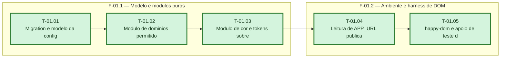

# Fases — Sprint 01

> O paralelismo declarado aqui é definitivo: nenhuma fase nem task corre em paralelo.

---

## F-01.1 — Modelo e modulos puros

**Objetivo:** Tabela, dominios e cor prontos e testados.

**Tasks que a compõem:** T-01.01, T-01.02, T-01.03

**Critério de saída:** Tabela, dominios e cor prontos e testados.

**Roda em paralelo com:** nenhuma

---

## F-01.2 — Ambiente e harness de DOM

**Objetivo:** APP_URL publica e ambiente de teste com DOM.

**Tasks que a compõem:** T-01.04, T-01.05

**Critério de saída:** APP_URL publica e ambiente de teste com DOM.

**Roda em paralelo com:** nenhuma
