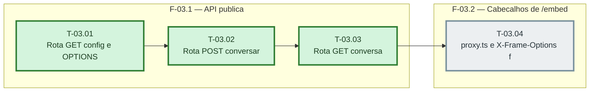

# Fases — Sprint 03

> O paralelismo declarado aqui é definitivo: nenhuma fase nem task corre em paralelo.

---

## F-03.1 — API publica

**Objetivo:** As tres rotas publicas por HTTP real.

**Tasks que a compõem:** T-03.01, T-03.02, T-03.03

**Critério de saída:** As tres rotas publicas por HTTP real.

**Roda em paralelo com:** nenhuma

---

## F-03.2 — Cabecalhos de /embed

**Objetivo:** proxy.ts e next.config.ts.

**Tasks que a compõem:** T-03.04

**Critério de saída:** proxy.ts e next.config.ts.

**Roda em paralelo com:** nenhuma
