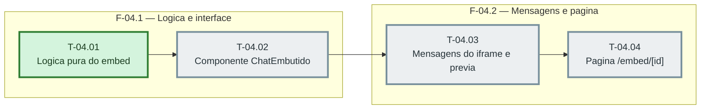

# Fases — Sprint 04

> O paralelismo declarado aqui é definitivo: nenhuma fase nem task corre em paralelo.

---

## F-04.1 — Logica e interface

**Objetivo:** Modulos puros e componente de chat.

**Tasks que a compõem:** T-04.01, T-04.02

**Critério de saída:** Modulos puros e componente de chat.

**Roda em paralelo com:** nenhuma

---

## F-04.2 — Mensagens e pagina

**Objetivo:** postMessage com o pai e a rota /embed/[id].

**Tasks que a compõem:** T-04.03, T-04.04

**Critério de saída:** postMessage com o pai e a rota /embed/[id].

**Roda em paralelo com:** nenhuma
