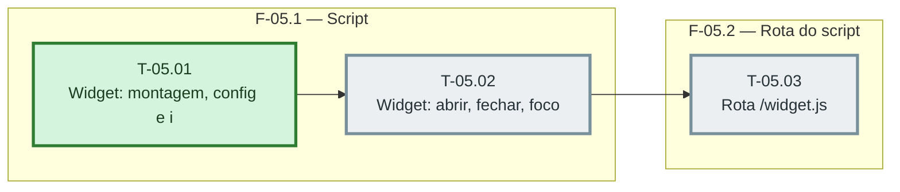

# Fases — Sprint 05

> O paralelismo declarado aqui é definitivo: nenhuma fase nem task corre em paralelo.

---

## F-05.1 — Script

**Objetivo:** Montagem e interacao do widget.

**Tasks que a compõem:** T-05.01, T-05.02

**Critério de saída:** Montagem e interacao do widget.

**Roda em paralelo com:** nenhuma

---

## F-05.2 — Rota do script

**Objetivo:** /widget.js em producao.

**Tasks que a compõem:** T-05.03

**Critério de saída:** /widget.js em producao.

**Roda em paralelo com:** nenhuma
