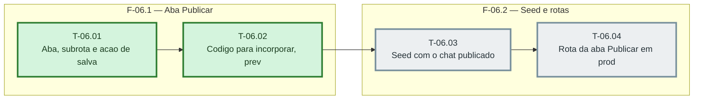

# Fases — Sprint 06

> O paralelismo declarado aqui é definitivo: nenhuma fase nem task corre em paralelo.

---

## F-06.1 — Aba Publicar

**Objetivo:** Formulario, previa e codigo.

**Tasks que a compõem:** T-06.01, T-06.02

**Critério de saída:** Formulario, previa e codigo.

**Roda em paralelo com:** nenhuma

---

## F-06.2 — Seed e rotas

**Objetivo:** Agente de exemplo publicado e a aba em producao.

**Tasks que a compõem:** T-06.03, T-06.04

**Critério de saída:** Agente de exemplo publicado e a aba em producao.

**Roda em paralelo com:** nenhuma
