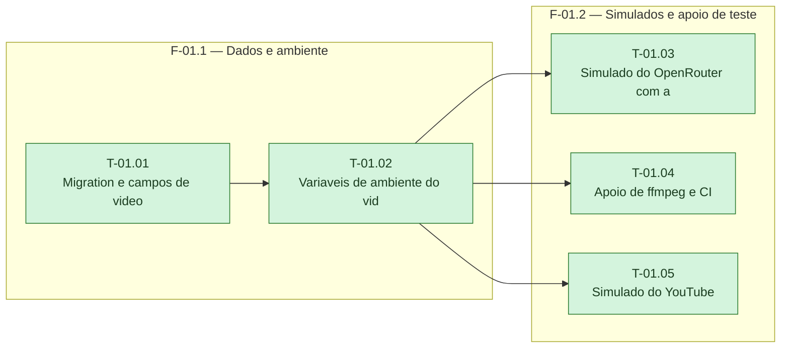

# Fases — Sprint 01

> O paralelismo declarado aqui é definitivo: nenhuma fase nem task corre em paralelo.

---

## F-01.1 — Dados e ambiente

**Objetivo:** Migration e variaveis de ambiente prontas e testadas.

**Tasks que a compõem:** T-01.01, T-01.02

**Critério de saída:** Migration e variaveis de ambiente prontas e testadas.

**Roda em paralelo com:** nenhuma

---

## F-01.2 — Simulados e apoio de teste

**Objetivo:** Simulados de OpenRouter com audio e de YouTube, e apoio de ffmpeg, testados.

**Tasks que a compõem:** T-01.03, T-01.04, T-01.05

**Critério de saída:** Simulados de OpenRouter com audio e de YouTube, e apoio de ffmpeg, testados.

**Roda em paralelo com:** nenhuma

---

