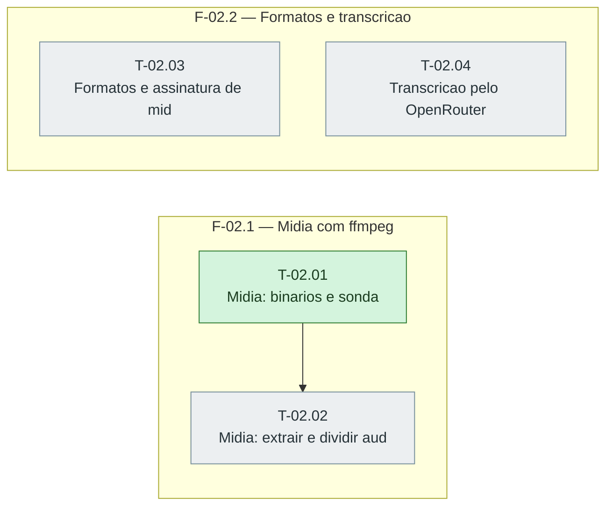

# Fases — Sprint 02

> O paralelismo declarado aqui é definitivo: nenhuma fase nem task corre em paralelo.

---

## F-02.1 — Midia com ffmpeg

**Objetivo:** Sonda, extracao e divisao de audio testadas, inclusive binario ausente.

**Tasks que a compõem:** T-02.01, T-02.02

**Critério de saída:** Sonda, extracao e divisao de audio testadas, inclusive binario ausente.

**Roda em paralelo com:** nenhuma

---

## F-02.2 — Formatos e transcricao

**Objetivo:** Assinaturas de midia e transcreverAudio testados.

**Tasks que a compõem:** T-02.03, T-02.04

**Critério de saída:** Assinaturas de midia e transcreverAudio testados.

**Roda em paralelo com:** nenhuma

---

