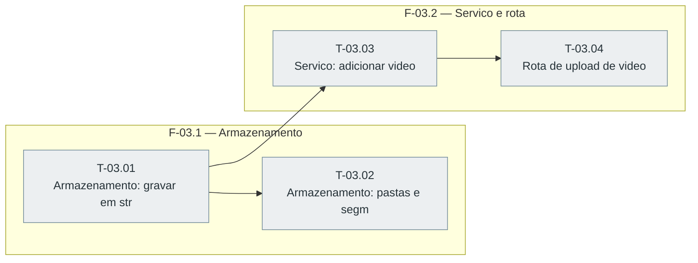

# Fases — Sprint 03

> O paralelismo declarado aqui é definitivo: nenhuma fase nem task corre em paralelo.

---

## F-03.1 — Armazenamento

**Objetivo:** Gravacao em stream e pastas de trabalho testadas.

**Tasks que a compõem:** T-03.01, T-03.02

**Critério de saída:** Gravacao em stream e pastas de trabalho testadas.

**Roda em paralelo com:** nenhuma

---

## F-03.2 — Servico e rota

**Objetivo:** Servico adicionarVideo e handler testados, inclusive contra next start.

**Tasks que a compõem:** T-03.03, T-03.04

**Critério de saída:** Servico adicionarVideo e handler testados, inclusive contra next start.

**Roda em paralelo com:** nenhuma

---

