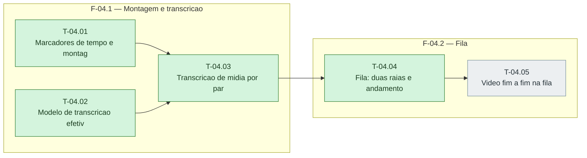

# Fases — Sprint 04

> O paralelismo declarado aqui é definitivo: nenhuma fase nem task corre em paralelo.

---

## F-04.1 — Montagem e transcricao

**Objetivo:** Marcadores, modelo efetivo e transcreverMidia testados.

**Tasks que a compõem:** T-04.01, T-04.02, T-04.03

**Critério de saída:** Marcadores, modelo efetivo e transcreverMidia testados.

**Roda em paralelo com:** nenhuma

---

## F-04.2 — Fila

**Objetivo:** Raias, andamento e fim a fim com ffmpeg real e OpenRouter simulado.

**Tasks que a compõem:** T-04.04, T-04.05

**Critério de saída:** Raias, andamento e fim a fim com ffmpeg real e OpenRouter simulado.

**Roda em paralelo com:** nenhuma

---

