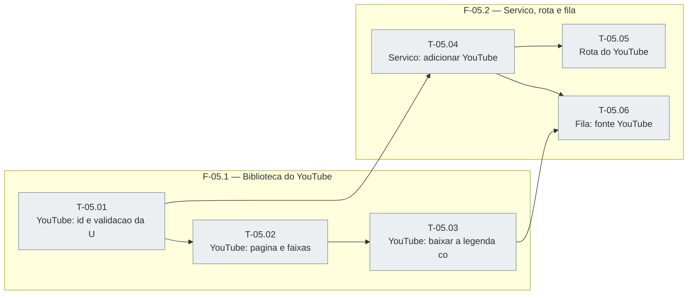

# Fases — Sprint 05

> O paralelismo declarado aqui é definitivo: nenhuma fase nem task corre em paralelo.

---

## F-05.1 — Biblioteca do YouTube

**Objetivo:** Id, pagina, faixas e legenda com SSRF testados contra o simulado.

**Tasks que a compõem:** T-05.01, T-05.02, T-05.03

**Critério de saída:** Id, pagina, faixas e legenda com SSRF testados contra o simulado.

**Roda em paralelo com:** nenhuma

---

## F-05.2 — Servico, rota e fila

**Objetivo:** Servico, rota e fila do YouTube testados.

**Tasks que a compõem:** T-05.04, T-05.05, T-05.06

**Critério de saída:** Servico, rota e fila do YouTube testados.

**Roda em paralelo com:** nenhuma

---

