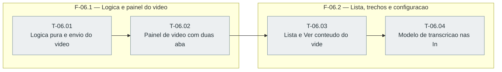

# Fases — Sprint 06

> O paralelismo declarado aqui é definitivo: nenhuma fase nem task corre em paralelo.

---

## F-06.1 — Logica e painel do video

**Objetivo:** Logica pura, opcao Video e painel com duas abas testados.

**Tasks que a compõem:** T-06.01, T-06.02

**Critério de saída:** Logica pura, opcao Video e painel com duas abas testados.

**Roda em paralelo com:** nenhuma

---

## F-06.2 — Lista, trechos e configuracao

**Objetivo:** Linha de fonte, ver conteudo e modelo de transcricao testados.

**Tasks que a compõem:** T-06.03, T-06.04

**Critério de saída:** Linha de fonte, ver conteudo e modelo de transcricao testados.

**Roda em paralelo com:** nenhuma

---

