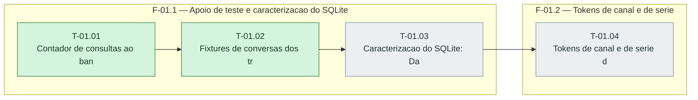

# Fases — Sprint 01

> O paralelismo declarado aqui é definitivo: nenhuma fase nem task corre em paralelo.

---

## F-01.1 — Apoio de teste e caracterizacao do SQLite

**Objetivo:** Apoio de teste e caracterizacao do SQLite.

**Tasks que a compõem:** T-01.01, T-01.02, T-01.03

**Critério de saída:** O contador, as fixtures e a caracterizacao do SQLite passam em teste.

**Roda em paralelo com:** nenhuma

---

## F-01.2 — Tokens de canal e de serie

**Objetivo:** Tokens de canal e de serie.

**Tasks que a compõem:** T-01.04

**Critério de saída:** Tokens de canal e de serie existem nos tres blocos com contraste de 4,5:1.

**Roda em paralelo com:** nenhuma

