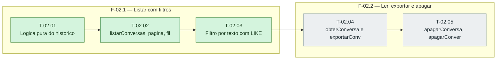

# Fases — Sprint 02

> O paralelismo declarado aqui é definitivo: nenhuma fase nem task corre em paralelo.

---

## F-02.1 — Listar com filtros

**Objetivo:** Listar com filtros.

**Tasks que a compõem:** T-02.01, T-02.02, T-02.03

**Critério de saída:** listarConversas pagina, filtra e ordena com uma consulta agregada.

**Roda em paralelo com:** nenhuma

---

## F-02.2 — Ler, exportar e apagar

**Objetivo:** Ler, exportar e apagar.

**Tasks que a compõem:** T-02.04, T-02.05

**Critério de saída:** obterConversa, exportarConversaTexto, apagarConversa e apagarConversas passam em teste.

**Roda em paralelo com:** nenhuma

