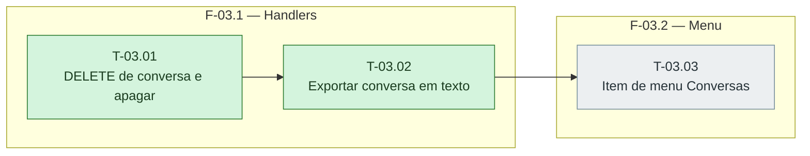

# Fases — Sprint 03

> O paralelismo declarado aqui é definitivo: nenhuma fase nem task corre em paralelo.

---

## F-03.1 — Handlers

**Objetivo:** Handlers.

**Tasks que a compõem:** T-03.01, T-03.02

**Critério de saída:** Os tres handlers passam contra o servidor de producao.

**Roda em paralelo com:** nenhuma

---

## F-03.2 — Menu

**Objetivo:** Menu.

**Tasks que a compõem:** T-03.03

**Critério de saída:** Conversas aparece no menu abaixo de Agentes e herda o titulo no detalhe.

**Roda em paralelo com:** nenhuma

