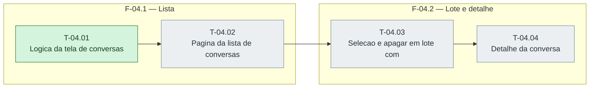

# Fases — Sprint 04

> O paralelismo declarado aqui é definitivo: nenhuma fase nem task corre em paralelo.

---

## F-04.1 — Lista

**Objetivo:** Lista.

**Tasks que a compõem:** T-04.01, T-04.02

**Critério de saída:** A lista renderiza filtros, badges, paginacao e estados.

**Roda em paralelo com:** nenhuma

---

## F-04.2 — Lote e detalhe

**Objetivo:** Lote e detalhe.

**Tasks que a compõem:** T-04.03, T-04.04

**Critério de saída:** O lote apaga com confirmacao na tela e o detalhe mostra a transcricao segura com fontes.

**Roda em paralelo com:** nenhuma

