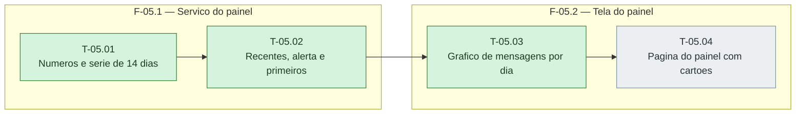

# Fases — Sprint 05

> O paralelismo declarado aqui é definitivo: nenhuma fase nem task corre em paralelo.

---

## F-05.1 — Servico do painel

**Objetivo:** Servico do painel.

**Tasks que a compõem:** T-05.01, T-05.02

**Critério de saída:** painel.ts devolve numeros, serie, recentes e primeiros passos.

**Roda em paralelo com:** nenhuma

---

## F-05.2 — Tela do painel

**Objetivo:** Tela do painel.

**Tasks que a compõem:** T-05.03, T-05.04

**Critério de saída:** O painel renderiza grafico acessivel, cartoes e listas com os tres estados.

**Roda em paralelo com:** nenhuma

