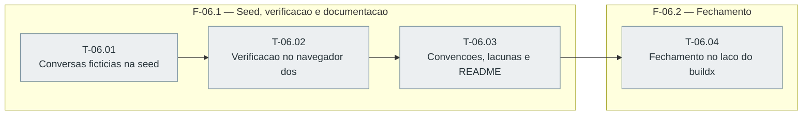

# Fases — Sprint 06

> O paralelismo declarado aqui é definitivo: nenhuma fase nem task corre em paralelo.

---

## F-06.1 — Seed, verificacao e documentacao

**Objetivo:** Seed, verificacao e documentacao.

**Tasks que a compõem:** T-06.01, T-06.02, T-06.03

**Critério de saída:** A seed tem as conversas, a verificacao esta registrada e as convencoes estao atualizadas.

**Roda em paralelo com:** nenhuma

---

## F-06.2 — Fechamento

**Objetivo:** Fechamento.

**Tasks que a compõem:** T-06.04

**Critério de saída:** MAPA, premissas, recursao e projeto atualizados e o portao pronto.

**Roda em paralelo com:** nenhuma

