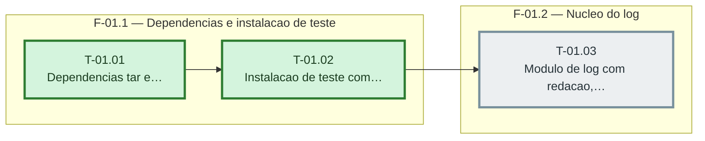

# Fases — Sprint 01

> O paralelismo declarado aqui é definitivo: nenhuma fase nem task corre em paralelo.

---

## F-01.1 — Dependencias e instalacao de teste

**Objetivo:** Dependencias e instalacao de teste.

**Tasks que a compõem:** T-01.01, T-01.02

**Critério de saída:** A prova das ferramentas e o apoio de instalacao passam em teste.

**Roda em paralelo com:** nenhuma

---

## F-01.2 — Nucleo do log

**Objetivo:** Nucleo do log.

**Tasks que a compõem:** T-01.03

**Critério de saída:** tests/log.test.ts passa com redacao, niveis, correlacao e erro sem pilha.

**Roda em paralelo com:** nenhuma

---

