# Fases — Sprint 02

> O paralelismo declarado aqui é definitivo: nenhuma fase nem task corre em paralelo.

```mermaid
%% Grafo de tasks — sprint-02 — gerado pela sprintx a partir de tasks.md
flowchart LR
  subgraph fase_02_1["F-02.1 — Correlacao e fim do console"]
    T_02_01["T-02.01<br/>Correlacao por requisicao…"]
    T_02_02["T-02.02<br/>Servicos de conhecimento,…"]
    T_02_03["T-02.03<br/>Camada de apresentacao e…"]
    T_02_04["T-02.04<br/>Chat, auditoria e expurgo…"]
    T_02_05["T-02.05<br/>Regra que proibe console…"]
  end
  subgraph fase_02_2["F-02.2 — Erro com codigo de referencia"]
    T_02_06["T-02.06<br/>Paginas de erro e not-found…"]
    T_02_07["T-02.07<br/>A pilha nao vaza em rota de…"]
  end
  T_02_01 --> T_02_02
  T_02_02 --> T_02_03
  T_02_03 --> T_02_04
  T_02_04 --> T_02_05
  T_02_05 --> T_02_06
  T_02_06 --> T_02_07

  classDef concluida fill:#d4f4dd,stroke:#2e7d32,color:#1b3d20
  classDef andamento fill:#fff3cd,stroke:#b8860b,color:#4a3800
  classDef bloqueada fill:#f8d7da,stroke:#c62828,color:#4a1d1f
  classDef pendente  fill:#eceff1,stroke:#78909c,color:#263238
  classDef critico   stroke-width:3px

  class T_02_01 concluida
  class T_02_02 concluida
  class T_02_03 concluida
  class T_02_04 concluida
  class T_02_05 concluida
  class T_02_06 pendente
  class T_02_07 pendente
  class T_02_07,T_02_06,T_02_05,T_02_04,T_02_03,T_02_02,T_02_01 critico
```

---

## F-02.1 — Correlacao e fim do console

**Objetivo:** Correlacao e fim do console.

**Tasks que a compõem:** T-02.01, T-02.02, T-02.03, T-02.04, T-02.05

**Critério de saída:** O proxy marca toda resposta, nenhum console.* resta em src/ e a regra de arquitetura falha se um novo aparecer.

**Roda em paralelo com:** nenhuma

---

## F-02.2 — Erro com codigo de referencia

**Objetivo:** Erro com codigo de referencia.

**Tasks que a compõem:** T-02.06, T-02.07

**Critério de saída:** error, global-error e not-found mostram o codigo e o teste contra next start prova que a pilha nao vaza.

**Roda em paralelo com:** nenhuma

---

