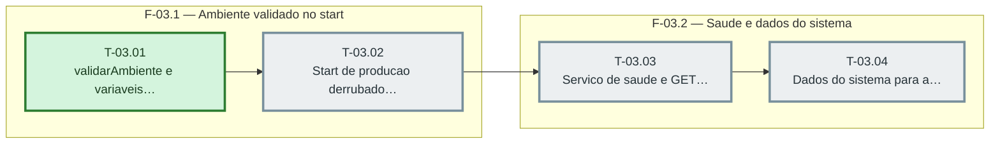

# Fases — Sprint 03

> O paralelismo declarado aqui é definitivo: nenhuma fase nem task corre em paralelo.

---

## F-03.1 — Ambiente validado no start

**Objetivo:** Ambiente validado no start.

**Tasks que a compõem:** T-03.01, T-03.02

**Critério de saída:** validarAmbiente lista os nomes ausentes e o servidor de producao nao sobe sem eles.

**Roda em paralelo com:** nenhuma

---

## F-03.2 — Saude e dados do sistema

**Objetivo:** Saude e dados do sistema.

**Tasks que a compõem:** T-03.03, T-03.04

**Critério de saída:** tests/saude.test.ts, tests/saude-rota.test.ts e tests/sistema.test.ts passam.

**Roda em paralelo com:** nenhuma

---

