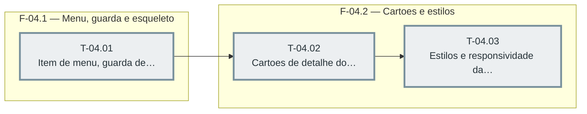

# Fases — Sprint 04

> O paralelismo declarado aqui é definitivo: nenhuma fase nem task corre em paralelo.

---

## F-04.1 — Menu, guarda e esqueleto

**Objetivo:** Menu, guarda e esqueleto.

**Tasks que a compõem:** T-04.01

**Critério de saída:** O item Sistema aparece so para admin e o nao admin recebe 307.

**Roda em paralelo com:** nenhuma

---

## F-04.2 — Cartoes e estilos

**Objetivo:** Cartoes e estilos.

**Tasks que a compõem:** T-04.02, T-04.03

**Critério de saída:** Os cartoes mostram o detalhe e o CSS prova 375 px e tokens.

**Roda em paralelo com:** nenhuma

---

