# Fases — Sprint 05

> O paralelismo declarado aqui é definitivo: nenhuma fase nem task corre em paralelo.

```mermaid
%% Grafo de tasks — sprint-05 — gerado pela sprintx a partir de tasks.md
flowchart LR
  subgraph fase_05_1["F-05.1 — Biblioteca de backup"]
    T_05_01["T-05.01<br/>gerarBackup: copia…"]
    T_05_02["T-05.02<br/>Backup sem temporarios, com…"]
  end
  subgraph fase_05_2["F-05.2 — Servico, auditoria e comando"]
    T_05_03["T-05.03<br/>Acao de auditoria…"]
    T_05_04["T-05.04<br/>Servico de backup: gerar,…"]
    T_05_05["T-05.05<br/>Comando npm run backup"]
  end
  subgraph fase_05_3["F-05.3 — Download e tela"]
    T_05_06["T-05.06<br/>Download autenticado do…"]
    T_05_07["T-05.07<br/>Gerar, listar e baixar…"]
  end
  T_05_01 --> T_05_02
  T_05_02 --> T_05_03
  T_05_03 --> T_05_04
  T_05_04 --> T_05_05
  T_05_05 --> T_05_06
  T_05_06 --> T_05_07

  classDef concluida fill:#d4f4dd,stroke:#2e7d32,color:#1b3d20
  classDef andamento fill:#fff3cd,stroke:#b8860b,color:#4a3800
  classDef bloqueada fill:#f8d7da,stroke:#c62828,color:#4a1d1f
  classDef pendente  fill:#eceff1,stroke:#78909c,color:#263238
  classDef critico   stroke-width:3px

  class T_05_01 concluida
  class T_05_02 concluida
  class T_05_03 concluida
  class T_05_04 concluida
  class T_05_05 concluida
  class T_05_06 pendente
  class T_05_07 pendente
  class T_05_07,T_05_06,T_05_05,T_05_04,T_05_03,T_05_02,T_05_01 critico
```

---

## F-05.1 — Biblioteca de backup

**Objetivo:** Biblioteca de backup.

**Tasks que a compõem:** T-05.01, T-05.02

**Critério de saída:** gerarBackup produz o arquivo com manifest, exclui temporarios, grava 0600 e aplica a retencao.

**Roda em paralelo com:** nenhuma

---

## F-05.2 — Servico, auditoria e comando

**Objetivo:** Servico, auditoria e comando.

**Tasks que a compõem:** T-05.03, T-05.04, T-05.05

**Critério de saída:** O servico exige admin, audita e o comando npm run backup funciona fora do servidor.

**Roda em paralelo com:** nenhuma

---

## F-05.3 — Download e tela

**Objetivo:** Download e tela.

**Tasks que a compõem:** T-05.06, T-05.07

**Critério de saída:** A rota entrega o arquivo e a tela gera, lista e baixa.

**Roda em paralelo com:** nenhuma

---

