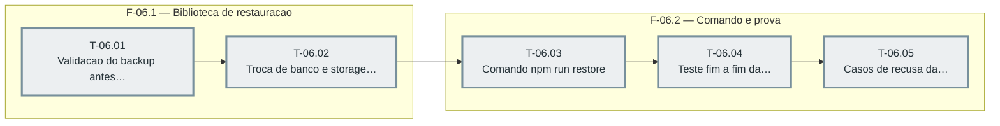

# Fases — Sprint 06

> O paralelismo declarado aqui é definitivo: nenhuma fase nem task corre em paralelo.

---

## F-06.1 — Biblioteca de restauracao

**Objetivo:** Biblioteca de restauracao.

**Tasks que a compõem:** T-06.01, T-06.02

**Critério de saída:** A validacao recusa o invalido sem efeito e a troca desfaz em falha.

**Roda em paralelo com:** nenhuma

---

## F-06.2 — Comando e prova

**Objetivo:** Comando e prova.

**Tasks que a compõem:** T-06.03, T-06.04, T-06.05

**Critério de saída:** O comando restaura e os testes fim a fim e de recusas passam.

**Roda em paralelo com:** nenhuma

---

