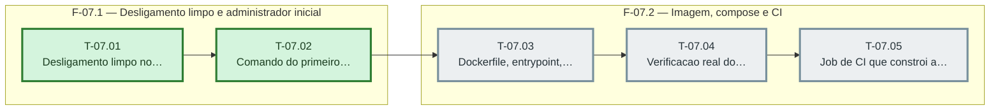

# Fases — Sprint 07

> O paralelismo declarado aqui é definitivo: nenhuma fase nem task corre em paralelo.

---

## F-07.1 — Desligamento limpo e administrador inicial

**Objetivo:** Desligamento limpo e administrador inicial.

**Tasks que a compõem:** T-07.01, T-07.02

**Critério de saída:** A fila para de reivindicar e o desligamento drena, e o comando cria o administrador sem imprimir senha.

**Roda em paralelo com:** nenhuma

---

## F-07.2 — Imagem, compose e CI

**Objetivo:** Imagem, compose e CI.

**Tasks que a compõem:** T-07.03, T-07.04, T-07.05

**Critério de saída:** Os arquivos de conteiner passam nos testes estaticos, a verificacao real passa e o CI constroi a imagem.

**Roda em paralelo com:** nenhuma

---

