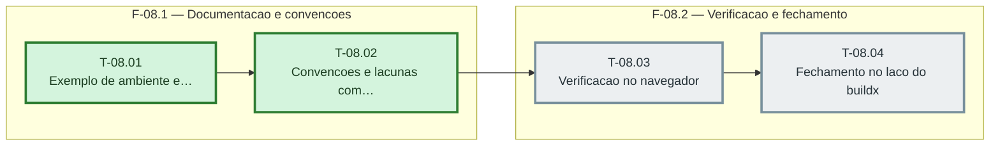

# Fases — Sprint 08

> O paralelismo declarado aqui é definitivo: nenhuma fase nem task corre em paralelo.

---

## F-08.1 — Documentacao e convencoes

**Objetivo:** Documentacao e convencoes.

**Tasks que a compõem:** T-08.01, T-08.02

**Critério de saída:** tests/projeto.test.ts confere README, exemplo de ambiente, convencoes e lacunas.

**Roda em paralelo com:** nenhuma

---

## F-08.2 — Verificacao e fechamento

**Objetivo:** Verificacao e fechamento.

**Tasks que a compõem:** T-08.03, T-08.04

**Critério de saída:** VERIFICACAO-VISUAL.md escrito e MAPA, PREMISSAS e RECURSAO atualizados.

**Roda em paralelo com:** nenhuma

---

