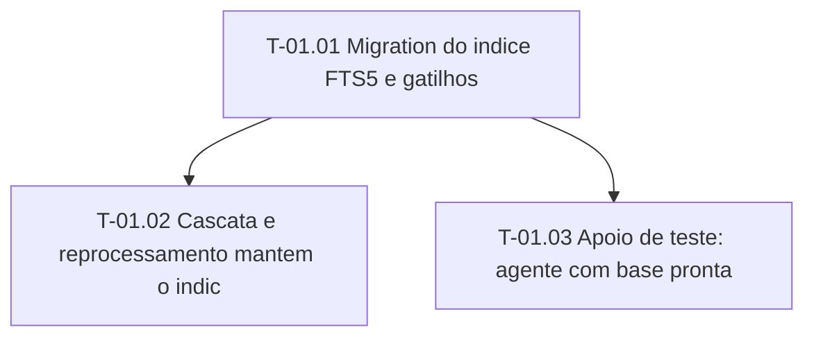

# Fases — Sprint 01

> O paralelismo declarado aqui é definitivo.

---

## F-01.1 — Migration e gatilhos

**Objetivo:** A migration aplica do zero e o indice acompanha insert, update, delete e rebuild.

**Tasks que a compõem:** T-01.01

**Critério de saída:** A migration aplica do zero e o indice acompanha insert, update, delete e rebuild.

**Roda em paralelo com:** nenhuma

---

## F-01.2 — Cascata, reprocessamento e apoio

**Objetivo:** O indice acompanha cascata e reprocessamento e ha helper de base pronta para os testes seguintes.

**Tasks que a compõem:** T-01.02, T-01.03

**Critério de saída:** O indice acompanha cascata e reprocessamento e ha helper de base pronta para os testes seguintes.

**Roda em paralelo com:** nenhuma

