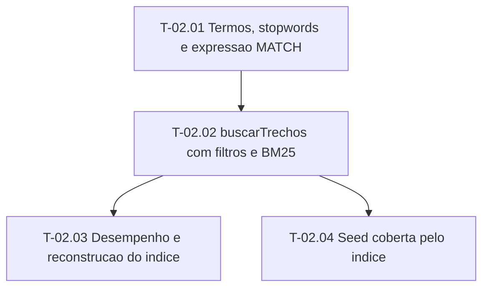

# Fases — Sprint 02

> O paralelismo declarado aqui é definitivo.

---

## F-02.1 — Termos e expressao MATCH

**Objetivo:** Funcoes puras de termos e expressao seguras.

**Tasks que a compõem:** T-02.01

**Critério de saída:** Funcoes puras de termos e expressao seguras.

**Roda em paralelo com:** nenhuma

---

## F-02.2 — Busca, desempenho e seed

**Objetivo:** buscarTrechos filtra, ordena, limita e e rapido; a seed e recuperavel.

**Tasks que a compõem:** T-02.02, T-02.03, T-02.04

**Critério de saída:** buscarTrechos filtra, ordena, limita e e rapido; a seed e recuperavel.

**Roda em paralelo com:** nenhuma

