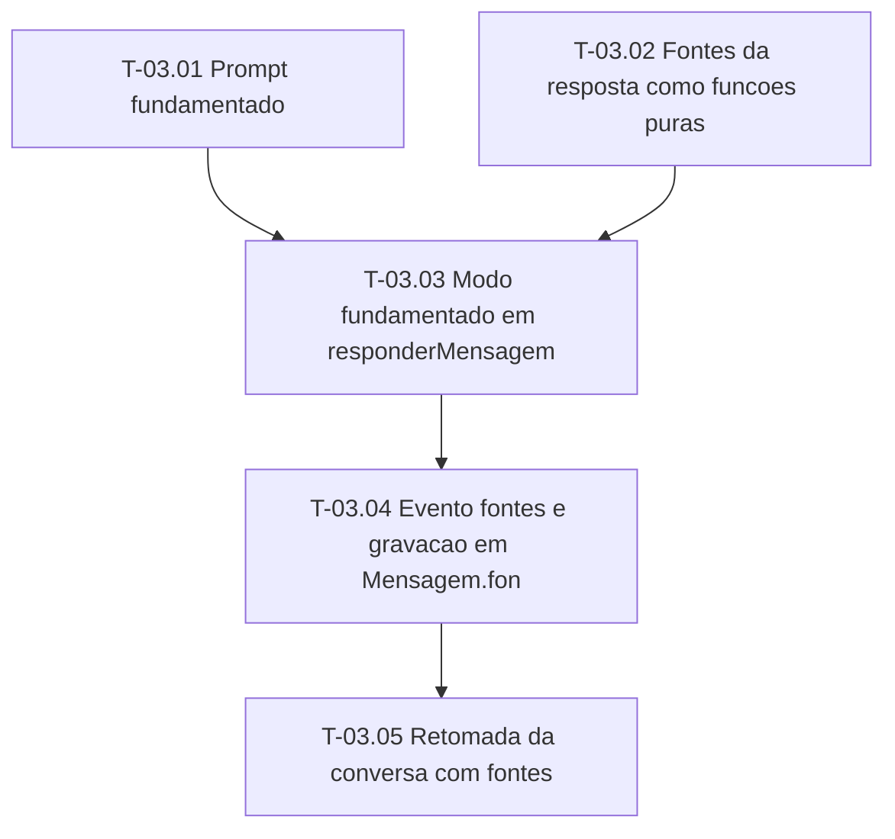

# Fases — Sprint 03

> O paralelismo declarado aqui é definitivo.

---

## F-03.1 — Pecas puras

**Objetivo:** Prompt fundamentado e fontes da resposta como funcoes puras.

**Tasks que a compõem:** T-03.01, T-03.02

**Critério de saída:** Prompt fundamentado e fontes da resposta como funcoes puras.

**Roda em paralelo com:** nenhuma

---

## F-03.2 — Integracao no turno

**Objetivo:** Modo fundamentado, evento e gravacao das fontes, retomada.

**Tasks que a compõem:** T-03.03, T-03.04, T-03.05

**Critério de saída:** Modo fundamentado, evento e gravacao das fontes, retomada.

**Roda em paralelo com:** nenhuma

