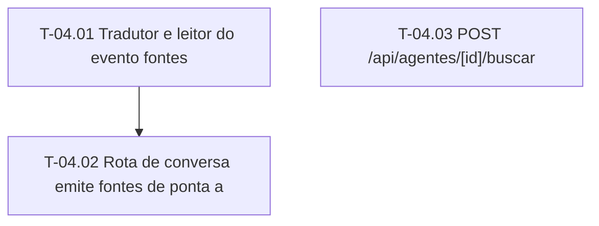

# Fases — Sprint 04

> O paralelismo declarado aqui é definitivo.

---

## F-04.1 — SSE compativel

**Objetivo:** Tradutor e leitor aceitam fontes.

**Tasks que a compõem:** T-04.01, T-04.02

**Critério de saída:** Tradutor e leitor aceitam fontes.

**Roda em paralelo com:** nenhuma

---

## F-04.2 — Rota de busca

**Objetivo:** Handler fino de busca com sessao e validacao.

**Tasks que a compõem:** T-04.03

**Critério de saída:** Handler fino de busca com sessao e validacao.

**Roda em paralelo com:** nenhuma

