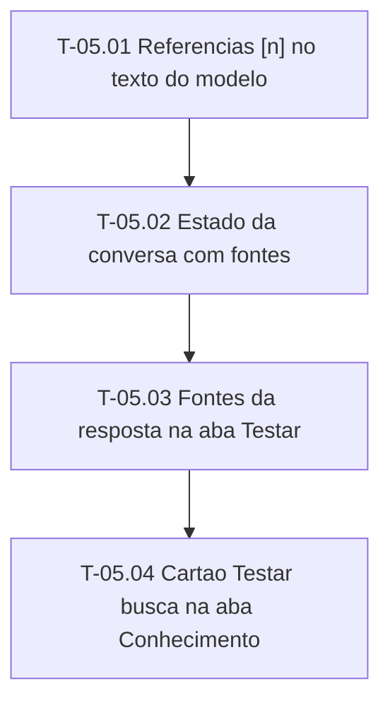

# Fases — Sprint 05

> O paralelismo declarado aqui é definitivo.

---

## F-05.1 — Logica pura da conversa

**Objetivo:** Referencias [n] e estado com fontes.

**Tasks que a compõem:** T-05.01, T-05.02

**Critério de saída:** Referencias [n] e estado com fontes.

**Roda em paralelo com:** nenhuma

---

## F-05.2 — Componentes e estilos

**Objetivo:** Fontes da resposta, chat integrado e Testar busca.

**Tasks que a compõem:** T-05.03, T-05.04

**Critério de saída:** Fontes da resposta, chat integrado e Testar busca.

**Roda em paralelo com:** nenhuma

