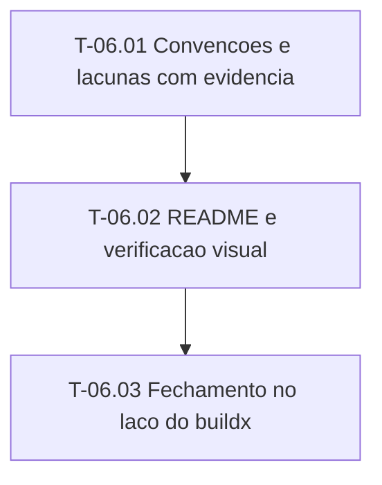

# Fases — Sprint 06

> O paralelismo declarado aqui é definitivo.

---

## F-06.1 — Convencoes e verificacao visual

**Objetivo:** Evidencia em docs/stack, README e verificacao visual.

**Tasks que a compõem:** T-06.01, T-06.02

**Critério de saída:** Evidencia em docs/stack, README e verificacao visual.

**Roda em paralelo com:** nenhuma

---

## F-06.2 — Fechamento

**Objetivo:** Registro da feature no laco do buildx.

**Tasks que a compõem:** T-06.03

**Critério de saída:** Registro da feature no laco do buildx.

**Roda em paralelo com:** nenhuma

