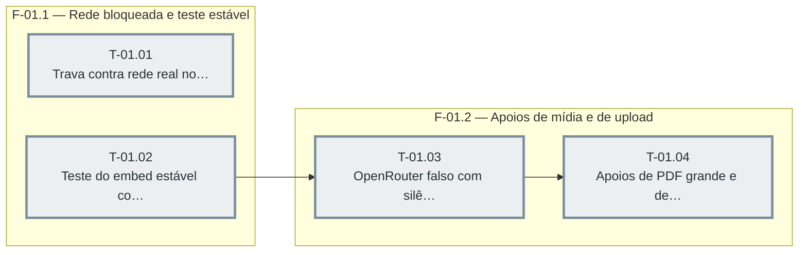

# Fases — Sprint 01

> O paralelismo declarado aqui é definitivo: nenhuma fase nem task corre em paralelo (todas compartilham o banco de teste e a suíte roda sem paralelismo).

---

## F-01.1 — Rede bloqueada e teste estável

**Objetivo:** Rede bloqueada e teste estável.

**Tasks que a compõem:** T-01.01, T-01.02

**Critério de saída:** as tasks T-01.01, T-01.02 concluídas com os dois testes passando.

**Roda em paralelo com:** nenhuma

---

## F-01.2 — Apoios de mídia e de upload

**Objetivo:** Apoios de mídia e de upload.

**Tasks que a compõem:** T-01.03, T-01.04

**Critério de saída:** as tasks T-01.03, T-01.04 concluídas com os dois testes passando.

**Roda em paralelo com:** nenhuma

