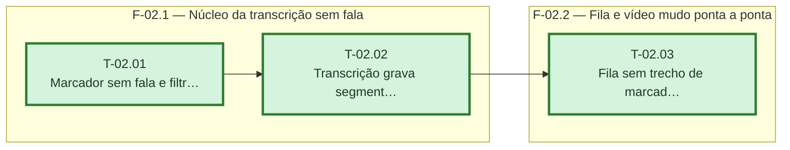

# Fases — Sprint 02

> O paralelismo declarado aqui é definitivo: nenhuma fase nem task corre em paralelo (todas compartilham o banco de teste e a suíte roda sem paralelismo).

---

## F-02.1 — Núcleo da transcrição sem fala

**Objetivo:** Núcleo da transcrição sem fala.

**Tasks que a compõem:** T-02.01, T-02.02

**Critério de saída:** as tasks T-02.01, T-02.02 concluídas com os dois testes passando.

**Roda em paralelo com:** nenhuma

---

## F-02.2 — Fila e vídeo mudo ponta a ponta

**Objetivo:** Fila e vídeo mudo ponta a ponta.

**Tasks que a compõem:** T-02.03

**Critério de saída:** as tasks T-02.03 concluídas com os dois testes passando.

**Roda em paralelo com:** nenhuma

