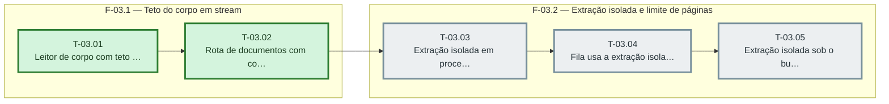

# Fases — Sprint 03

> O paralelismo declarado aqui é definitivo: nenhuma fase nem task corre em paralelo (todas compartilham o banco de teste e a suíte roda sem paralelismo).

---

## F-03.1 — Teto do corpo em stream

**Objetivo:** Teto do corpo em stream.

**Tasks que a compõem:** T-03.01, T-03.02

**Critério de saída:** as tasks T-03.01, T-03.02 concluídas com os dois testes passando.

**Roda em paralelo com:** nenhuma

---

## F-03.2 — Extração isolada e limite de páginas

**Objetivo:** Extração isolada e limite de páginas.

**Tasks que a compõem:** T-03.03, T-03.04, T-03.05

**Critério de saída:** as tasks T-03.03, T-03.04, T-03.05 concluídas com os dois testes passando.

**Roda em paralelo com:** nenhuma

