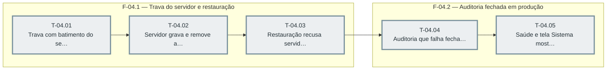

# Fases — Sprint 04

> O paralelismo declarado aqui é definitivo: nenhuma fase nem task corre em paralelo (todas compartilham o banco de teste e a suíte roda sem paralelismo).

---

## F-04.1 — Trava do servidor e restauração

**Objetivo:** Trava do servidor e restauração.

**Tasks que a compõem:** T-04.01, T-04.02, T-04.03

**Critério de saída:** as tasks T-04.01, T-04.02, T-04.03 concluídas com os dois testes passando.

**Roda em paralelo com:** nenhuma

---

## F-04.2 — Auditoria fechada em produção

**Objetivo:** Auditoria fechada em produção.

**Tasks que a compõem:** T-04.04, T-04.05

**Critério de saída:** as tasks T-04.04, T-04.05 concluídas com os dois testes passando.

**Roda em paralelo com:** nenhuma

