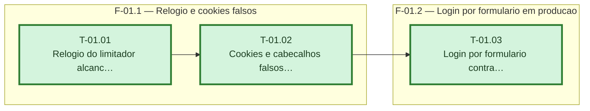

# Fases — Sprint 01

> O paralelismo declarado aqui é definitivo: nenhuma fase nem task corre em paralelo (todas compartilham o banco de teste e a suíte roda sem paralelismo).

---

## F-01.1 — Relogio e cookies falsos

**Objetivo:** Relogio e cookies falsos.

**Tasks que a compõem:** T-01.01, T-01.02

**Critério de saída:** as tasks T-01.01, T-01.02 concluídas com os dois testes passando.

**Roda em paralelo com:** nenhuma

---

## F-01.2 — Login por formulario em producao

**Objetivo:** Login por formulario em producao.

**Tasks que a compõem:** T-01.03

**Critério de saída:** as tasks T-01.03 concluídas com os dois testes passando.

**Roda em paralelo com:** nenhuma
