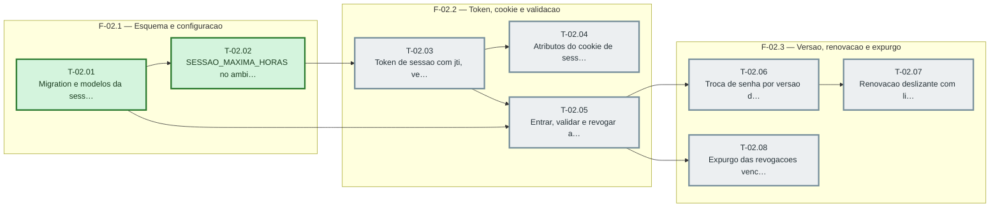

# Fases — Sprint 02

> O paralelismo declarado aqui é definitivo: nenhuma fase nem task corre em paralelo (todas compartilham o banco de teste e a suíte roda sem paralelismo).

---

## F-02.1 — Esquema e configuracao

**Objetivo:** Esquema e configuracao.

**Tasks que a compõem:** T-02.01, T-02.02

**Critério de saída:** as tasks T-02.01, T-02.02 concluídas com os dois testes passando.

**Roda em paralelo com:** nenhuma

---

## F-02.2 — Token, cookie e validacao

**Objetivo:** Token, cookie e validacao.

**Tasks que a compõem:** T-02.03, T-02.04, T-02.05

**Critério de saída:** as tasks T-02.03, T-02.04, T-02.05 concluídas com os dois testes passando.

**Roda em paralelo com:** nenhuma

---

## F-02.3 — Versao, renovacao e expurgo

**Objetivo:** Versao, renovacao e expurgo.

**Tasks que a compõem:** T-02.06, T-02.07, T-02.08

**Critério de saída:** as tasks T-02.06, T-02.07, T-02.08 concluídas com os dois testes passando.

**Roda em paralelo com:** nenhuma
