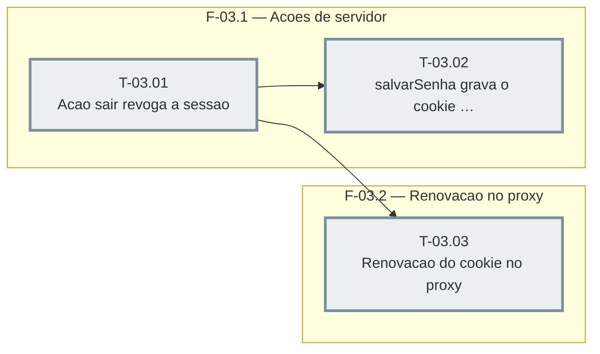

# Fases — Sprint 03

> O paralelismo declarado aqui é definitivo: nenhuma fase nem task corre em paralelo (todas compartilham o banco de teste e a suíte roda sem paralelismo).

---

## F-03.1 — Acoes de servidor

**Objetivo:** Acoes de servidor.

**Tasks que a compõem:** T-03.01, T-03.02

**Critério de saída:** as tasks T-03.01, T-03.02 concluídas com os dois testes passando.

**Roda em paralelo com:** nenhuma

---

## F-03.2 — Renovacao no proxy

**Objetivo:** Renovacao no proxy.

**Tasks que a compõem:** T-03.03

**Critério de saída:** as tasks T-03.03 concluídas com os dois testes passando.

**Roda em paralelo com:** nenhuma
