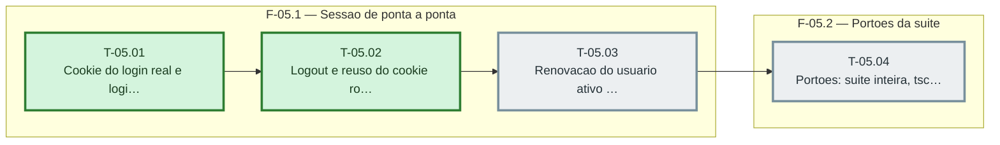

# Fases — Sprint 05

> O paralelismo declarado aqui é definitivo: nenhuma fase nem task corre em paralelo (todas compartilham o banco de teste e a suíte roda sem paralelismo).

---

## F-05.1 — Sessao de ponta a ponta

**Objetivo:** Sessao de ponta a ponta.

**Tasks que a compõem:** T-05.01, T-05.02, T-05.03

**Critério de saída:** as tasks T-05.01, T-05.02, T-05.03 concluídas com os dois testes passando.

**Roda em paralelo com:** nenhuma

---

## F-05.2 — Portoes da suite

**Objetivo:** Portoes da suite.

**Tasks que a compõem:** T-05.04

**Critério de saída:** as tasks T-05.04 concluídas com os dois testes passando.

**Roda em paralelo com:** nenhuma
