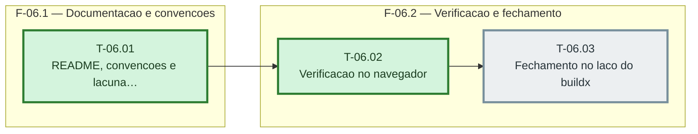

# Fases — Sprint 06

> O paralelismo declarado aqui é definitivo: nenhuma fase nem task corre em paralelo (todas compartilham o banco de teste e a suíte roda sem paralelismo).

---

## F-06.1 — Documentacao e convencoes

**Objetivo:** Documentacao e convencoes.

**Tasks que a compõem:** T-06.01

**Critério de saída:** as tasks T-06.01 concluídas com os dois testes passando.

**Roda em paralelo com:** nenhuma

---

## F-06.2 — Verificacao e fechamento

**Objetivo:** Verificacao e fechamento.

**Tasks que a compõem:** T-06.02, T-06.03

**Critério de saída:** as tasks T-06.02, T-06.03 concluídas com os dois testes passando.

**Roda em paralelo com:** nenhuma
